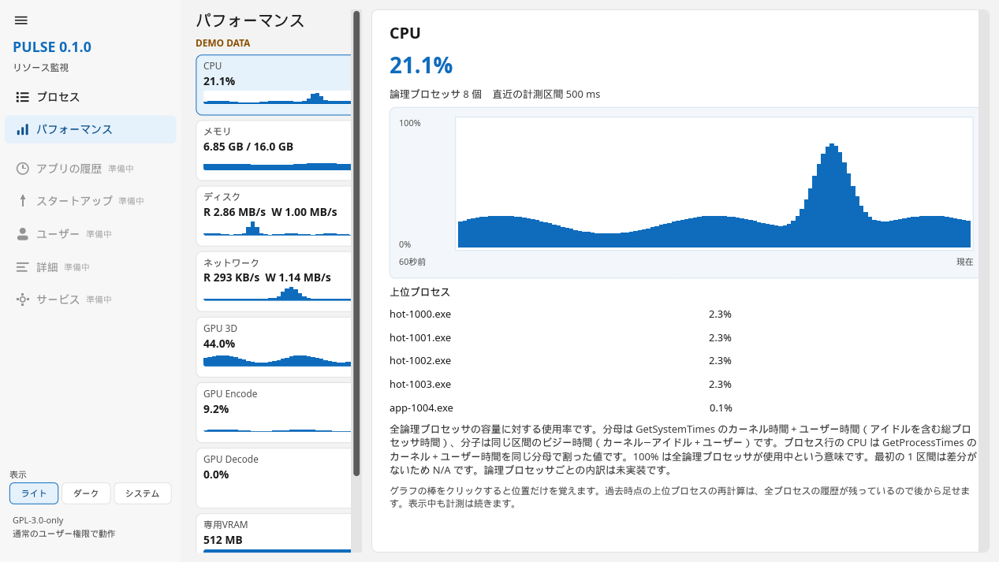
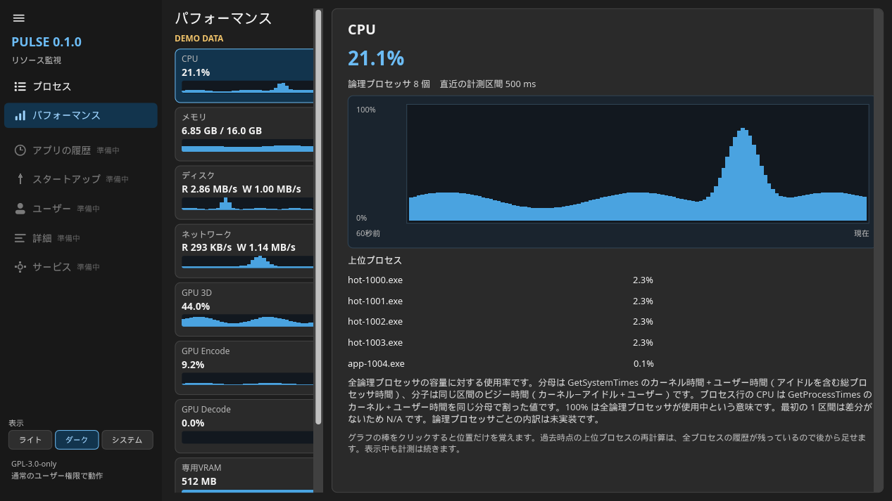
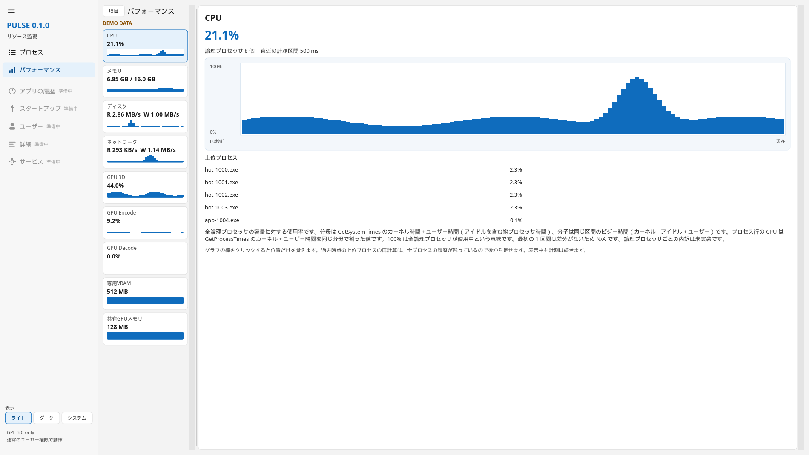
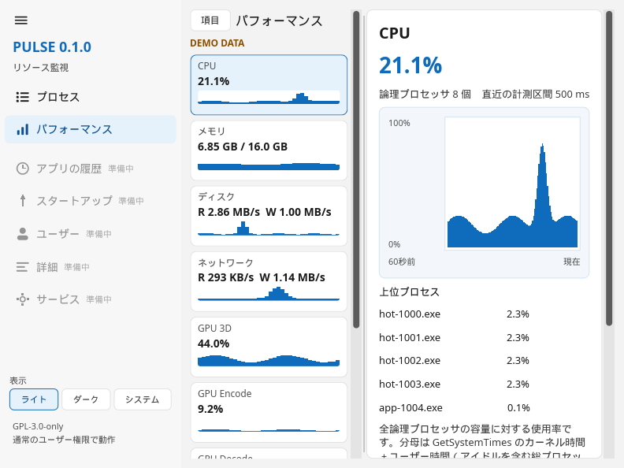
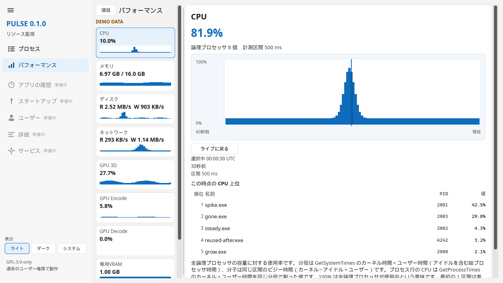

# PULSE

Process Usage and Load Surveillance Engine。Windows 11 向けの軽量タスクマネージャーです。

「いつ、どのプロセスが、どのリソースを使ったか」を後から追えることを目標にしています。Phase 1 は、そのための計測と表示の土台です。

## スクリーンショット

Linux 上のレイアウト確認です。`--features mock` の DEMO DATA で、Windows 11 の実測ではありません。











## デモデータで起動する（Linux）

通常の Release ビルドには入っていません。

```bash
cargo run --features mock -- --demo normal --page performance --size 1280x720 --theme light
```

シナリオは `normal`（100 プロセス）、`many`（1,000 プロセス）、`gaps`（N/A・未対応・実測 0）、`special`（出現、終了、PID 再利用、複数 GPU / ディスク / アダプター）、`history`（30 秒前の CPU スパイク、終了したプロセス、PID 再利用、2 つの GPU）、`cpus`（8 論理 CPU。CPU 間の移動、PID 再利用、30 秒前の CPU 5 が `heavy-cpu5.exe`）、`cpus32`（32 論理 CPU）、`cpus-denied`（詳細分析は権限不足。全体 CPU は出る）です。画面に `DEMO DATA` と出ます。乱数ではなく決まった式です。`DEMO` の診断行は ETW の実測ではありません。

```bash
cargo run --features mock -- --demo history --page performance --size 1280x720 --theme dark --select-history 59
```

`--resource` は `cpu` / `memory` / `disk` / `network` / `gpu3d` / `gpu-encode` / `gpu-decode` / `vram` / `shared` です。`--select-history N` は 60 秒軸の N 番目の棒を一度だけ固定します。`--age-history SECONDS` は `--demo` と `--select-history` と一緒のときだけ使えます。固定した記録を残したまま模擬時計を進め、グラフの外に出た選択（「選択中：○分○秒前」、選択線なし）を確認します。`--cpu-view overall|logical` は全体グラフと論理 CPU の格子です。`--select-cpu N` はその格子の CPU を選びます。`--cpu-detail on|off` は詳細分析です。`cpus` / `cpus32` / `cpus-denied` は、指定が無ければ論理 CPU 表示かつ分析オンで開きます。どれも画面確認用です。

## 主な機能（Phase 1）

- Windows 11 のタスクマネージャーに近い、左ナビゲーションと右メイン領域。左上のハンバーガーでアイコンだけの幅に折りたためる
- プロセスタブ: 実在のプロセス一覧、CPU 使用率、プライベートワーキングセット。縦横のスクロールバー付き
- 列ヘッダーのクリックで昇順・降順ソート。ヘッダーの右端をドラッグすると列幅が変わる。ヘッダーを左右にドラッグすると列の並びが変わり、右クリックのチェックで表示を切り替える。名前列は常に表示
- パフォーマンスの資源も「項目」メニューで並べ替えと表示切替ができる。一覧と詳細の境目をドラッグして幅を変える
- 表示はライト、ダーク、または Windows のアプリテーマ（システム）。切替は左ナビの下
- パフォーマンスタブ: 資源一覧、直近 60 秒のグラフ、その時点の上位 5 プロセス。グラフの棒をクリックするとその時点を固定し、「ライブに戻る」で最新に戻る。ホバーは時刻と値のプレビューだけ
- 計測スレッドと UI スレッドの分離
- 直近 60 秒分のスナップショットを固定長リングバッファに保持（全プロセス。上位 N 件だけは保存しない）
- プロセス別の I/O 速度と、それとは別の物理ディスク速度。プロセス別ネットワークは通常ユーザーでは `要管理者`。アダプター速度は別
- GPU 3D / Encode / Decode（最大。合計しない）、専用 VRAM と共有 GPU メモリ
- 計測できない値は `N/A`。GPU が無いときは `なし`。`0` や `0.0%` は実測がゼロのときだけ

列と資源の並び、非表示、分割位置は `%APPDATA%\PULSE\ui.cfg` に保存する。Linux では `~/.config/PULSE/ui.cfg`。環境変数 `PULSE_CONFIG_DIR` があればそのディレクトリを使う。ネットワークへは送らない。

検索は未実装です。ナビゲーションの「準備中」項目はその置き場です。論理プロセッサ別のグラフと上位 5 は、CPU 詳細の「論理CPU」です。割合はその CPU の時間 ÷ 区間で、全体 CPU とは分母が違います。詳細分析は既定でオフです。

## 対応 OS

- Windows 11 x86-64
- リリースの `PULSE.exe` は起動のたびに管理者への昇格（UAC）を求める。拒否すると起動しない
- 一部のプロセスは権限不足で CPU / メモリが `N/A` になる

Linux の通常ビルドは計測値を出さない。`mock` feature の `DEMO DATA` は計測結果ではない。

## インストール

安定版の GitHub Release は Phase 1 では作っていません。

Windows 用の `PULSE.exe` は、このリポジトリの GitHub Actions（`windows-latest`）がリリースビルドした成果物です。

1. Actions の成功した `fmt / clippy / test / build (Windows)` を開く
2. Artifacts の `PULSE-windows-x64` をダウンロードする
3. ZIP 内の `PULSE.exe` を Windows 11 x86-64 上で実行する

アーティファクトは GitHub の保存期限があるため、期限後は Actions を再実行するか、ソースからビルドしてください。

## ソースからビルド

Rust stable（1.95 以上。Slint 1.19 の要件）と、Windows では MSVC ビルドツールが必要です。

```powershell
git clone https://github.com/suraimu752/PULSE.git
cd PULSE
cargo build --release
.\target\release\PULSE.exe
```

デバッグビルドはコンソールを残します。リリースビルドはコンソールを出さず、起動失敗時はメッセージボックスを表示します。

## 必要な実行権限

リリースの `PULSE.exe` は、埋め込みマニフェスト（リソース ID 1）で起動前に管理者権限を求めます。UAC のプロンプトは起動のたびに出ます。拒否するとプロセスは始まりません。フッタの権限表示は、そのプロセスのトークン（`TokenElevation`）を読んだ結果です。読み取りは `PROCESS_QUERY_LIMITED_INFORMATION` のままです。昇格しても開けないプロセスは一覧に残し、CPU とメモリを `N/A` にします。数値は作りません。論理 CPU のプロセス分析は、CPU 詳細の「分析オン」のときだけ専用 ETW セッション `PULSE-CPU` を使います。権限が無ければその順位だけ `N/A` になり、他の機能は続きます。コードから「管理者として再起動」を起動時に呼ぶことはしません。ボタンは、昇格していない起動（テストや、マニフェストを外したビルド）のために残しています。ログオン時の自動起動は未実装です。後から入れる場合、`Run` キーだけでは UAC を越えられないため、最高権限のタスクスケジューラが必要です。

この版にプロセス終了機能はありません。

## 計測の制限事項

詳細は [docs/measurement.md](docs/measurement.md) です。要約:

- CPU は `GetSystemTimes` と `GetProcessTimes` の区間差分。100% は全論理プロセッサが埋まった状態
- 最初の約 0.5 秒は差分がないため CPU は `N/A`
- プロセスメモリはプライベートワーキングセット（`PROCESS_MEMORY_COUNTERS_EX2.PrivateWorkingSetSize`）。タスクマネージャーの「アクティブプライベートワーキングセット」とは一致しないことがある
- メモリは約 1 秒ごと、CPU は約 0.5 秒ごとに更新する。表示の再読込は約 0.25 秒で、計測とは別タイマー
- プロセス名は Toolhelp のイメージ名（`chrome.exe` など）。タスクマネージャーのフレンドリ名ではない
- PID 0 は Toolhelp では `[System Process]` のため、表示名だけ `System Idle Process` にする
- アイドルプロセスを開けない場合、その行は `N/A`。システム CPU は別計算なので、行が `N/A` でも全体 CPU は出る
- プロセスの I/O は `GetProcessIoCounters` で、ファイル以外も含む。物理ディスクの速度とは別
- プロセス別ネットワークは通常ユーザーでは取らない。画面は `要管理者`。アダプター速度は `GetIfTable2`
- GPU 使用率はエンジン種別の最大。専用と共有は別。カウンタが無いときは `なし`、読めないときは `N/A`
- 論理プロセッサ別の割合は、その CPU 上の時間 ÷ 区間。全体 CPU（`GetSystemTimes`）とは別計算で、ETW の値で全体 CPU は置き換えない。権限不足、分析オフ、最初の区間、欠測は `N/A`
- Windows 上の ETW セッションは CI では張れないため未検証。実機の数字は CPU ページの診断行（`DEMO` が無いもの）を見る。A は分析オフ、B は分析オンかつ全体、C は論理 CPU で時刻を固定
- Windows 上のディスク、ネットワーク、GPU の数値は実機では未検証。CI は API が落ちないことまで
- 詳細グラフは直近 60 秒。棒をクリックするとその時点の値と上位 5 を固定する。リングから落ちたあとも、選択中の 1 点だけは残る。60 秒より古い履歴をまとめて残すことはしない
- ディスクのグラフは物理ディスク、順位はプロセス I/O。プロセス別ネットワークは通常ユーザーでは順位を作らない
- 広告、テレメトリ、アカウント登録、常駐サービスはない

## ライセンス

[GPL-3.0-only](LICENSE)。依存関係の確認は [docs/licenses.md](docs/licenses.md)。

UI には Slint 1.19.0 を **GPL-3.0-only** として使っています。ロイヤリティフリーライセンスではないため、AboutSlint の表示義務はありません。

機能制限、広告、課金はありません。寄付先は未定のため `FUNDING.yml` は置いていません。

## バグ報告

[GitHub Issues](https://github.com/suraimu752/PULSE/issues) に、Windows の版、`PULSE.exe` を入手した Actions の実行 URL、再現手順、画面上の `N/A` と `0` の区別が分かる説明を書いてください。
