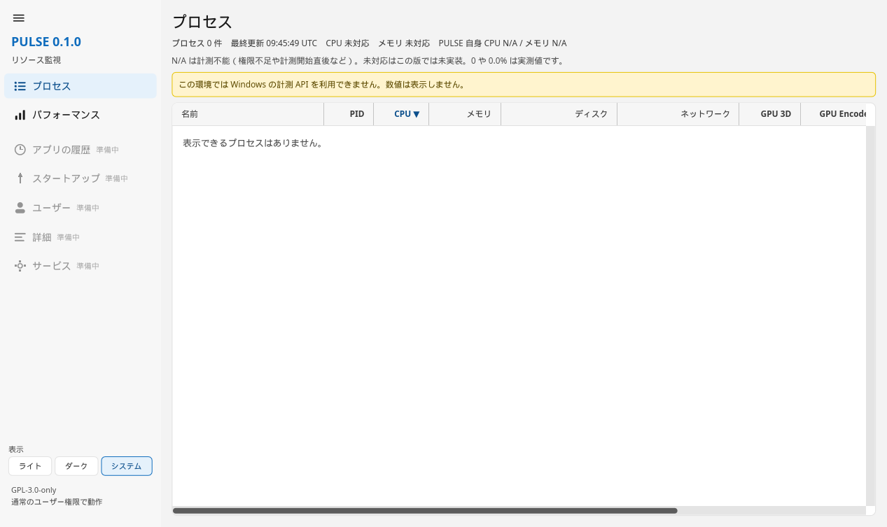
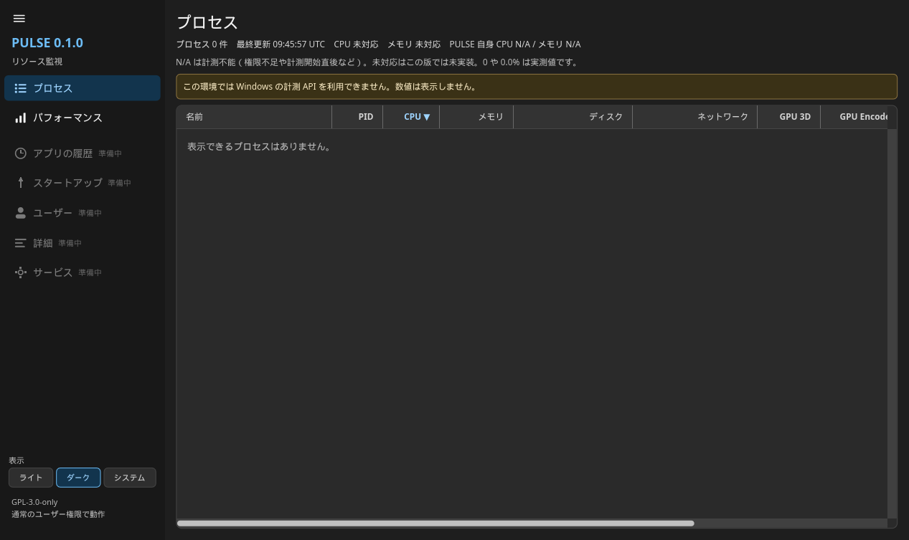

# PULSE

Process Usage and Load Surveillance Engine。Windows 11 向けの軽量タスクマネージャーです。

「いつ、どのプロセスが、どのリソースを使ったか」を後から追えることを目標にしています。Phase 1 は、そのための計測と表示の土台です。

## スクリーンショット

Linux 上のレイアウト確認です。プロセスは 0 件、CPU とメモリは `未対応` です。Windows 11 で起動した画面ではありません。





## 主な機能（Phase 1）

- Windows 11 のタスクマネージャーに近い、左ナビゲーションと右メイン領域。左上のハンバーガーでアイコンだけの幅に折りたためる
- プロセスタブ: 実在のプロセス一覧、CPU 使用率、プライベートワーキングセット。縦横のスクロールバー付き
- 列ヘッダーのクリックで昇順・降順ソート。ヘッダーの右端をドラッグすると列幅が変わる
- 表示はライト、ダーク、または Windows のアプリテーマ（システム）。切替は左ナビの下
- パフォーマンスタブ: CPU とメモリの現在値、直近 60 秒のグラフ
- 計測スレッドと UI スレッドの分離
- 直近 60 秒分のスナップショットを固定長リングバッファに保持（全プロセス。上位 N 件だけは保存しない）
- ディスク、ネットワーク、GPU、VRAM は未実装。`未対応` と表示し、実測の `0` とは区別する
- 計測できない値は `N/A`。`0` や `0.0%` は実測がゼロのときだけ

今後のフェーズで、ディスク / ネットワーク / GPU、検索と列管理、過去時点の選択、論理プロセッサ別ランキングを追加できる構成にしてあります。ナビゲーションの「準備中」項目はその置き場です。

## 対応 OS

- Windows 11 x86-64
- 通常のユーザー権限で起動する（常時の管理者権限は不要）
- 一部のプロセスは権限不足で CPU / メモリが `N/A` になる

Linux ではビルドと単体テストはできるが、計測値は出さない。ダミーの CPU やメモリは表示しない。

## インストール

安定版の GitHub Release は Phase 1 では作っていません。

Windows 用の `PULSE.exe` は、このリポジトリの GitHub Actions（`windows-latest`）がリリースビルドした成果物です。

1. Actions の成功した `fmt / clippy / test / build (Windows)` を開く
2. Artifacts の `PULSE-windows-x64` をダウンロードする
3. ZIP 内の `PULSE.exe` を Windows 11 x86-64 上で実行する

アーティファクトは GitHub の保存期限があるため、期限後は Actions を再実行するか、ソースからビルドしてください。

## ソースからビルド

Rust stable（1.95 以上。Slint 1.19 の要件）と、Windows では MSVC ビルドツールが必要です。

```powershell
git clone https://github.com/suraimu752/PULSE.git
cd PULSE
cargo build --release
.\target\release\PULSE.exe
```

デバッグビルドはコンソールを残します。リリースビルドはコンソールを出さず、起動失敗時はメッセージボックスを表示します。

## 必要な実行権限

管理者として実行しないでください。`PROCESS_QUERY_LIMITED_INFORMATION` で足りる情報だけを読みます。開けないプロセスは一覧には残し、CPU とメモリを `N/A` にします。

この版にプロセス終了機能はありません。

## 計測の制限事項

詳細は [docs/measurement.md](docs/measurement.md) です。要約:

- CPU は `GetSystemTimes` と `GetProcessTimes` の区間差分。100% は全論理プロセッサが埋まった状態
- 最初の約 0.5 秒は差分がないため CPU は `N/A`
- プロセスメモリはプライベートワーキングセット（`PROCESS_MEMORY_COUNTERS_EX2.PrivateWorkingSetSize`）。タスクマネージャーの「アクティブプライベートワーキングセット」とは一致しないことがある
- メモリは約 1 秒ごと、CPU は約 0.5 秒ごとに更新する。表示の再読込は約 0.25 秒で、計測とは別タイマー
- プロセス名は Toolhelp のイメージ名（`chrome.exe` など）。タスクマネージャーのフレンドリ名ではない
- PID 0 は Toolhelp では `[System Process]` のため、表示名だけ `System Idle Process` にする
- アイドルプロセスを開けない場合、その行は `N/A`。システム CPU は別計算なので、行が `N/A` でも全体 CPU は出る
- ディスク、ネットワーク、GPU、VRAM、論理プロセッサ別ランキングは未実装
- 履歴グラフのクリック選択と、その時点の上位 5 プロセスは未実装。リングバッファには全プロセスを保持している
- 広告、テレメトリ、アカウント登録、常駐サービスはない

## ライセンス

[GPL-3.0-only](LICENSE)。依存関係の確認は [docs/licenses.md](docs/licenses.md)。

UI には Slint 1.19.0 を **GPL-3.0-only** として使っています。ロイヤリティフリーライセンスではないため、AboutSlint の表示義務はありません。

機能制限、広告、課金はありません。寄付先は未定のため `FUNDING.yml` は置いていません。

## バグ報告

[GitHub Issues](https://github.com/suraimu752/PULSE/issues) に、Windows の版、`PULSE.exe` を入手した Actions の実行 URL、再現手順、画面上の `N/A` と `0` の区別が分かる説明を書いてください。
